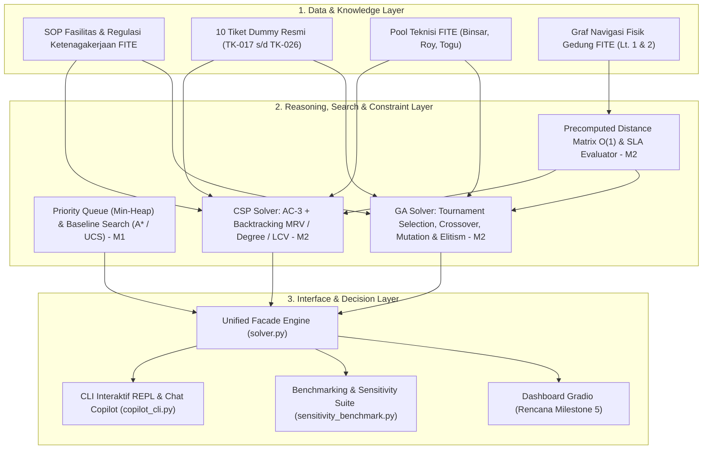

# Del-MaintOps Copilot

**Generative AI-Driven Facility Recommendation & Decision Support System for FITE IT Del**

Asisten cerdas bagi civitas akademika Fakultas Informatika dan Teknik Elektro (FITE) IT Del untuk melapor dan
menanyakan status kerusakan fasilitas gedung — proyektor/infokus, AC, jaringan/LAN lab, Idea Hub,
kelistrikan/colokan, CCTV, dan ruang kelas/labkom — sekaligus membantu tim sarana prasarana dan teknisi
memprioritaskan, mengalokasikan, serta menjadwalkan penanganan tiket secara optimal, terukur, dan mematuhi
seluruh batasan operasional (SOP, kualifikasi teknisi, dan SLA).

> Status Proyek: **Milestone 2 (W04)** — Modul Pemecahan Batasan Keputusan Bisnis (Constraint Satisfaction Problems & Genetic Algorithm Optimization).

---

## Arsitektur Tingkat Tinggi (3 Lapis — Milestone 1 & 2)



---

## Struktur Direktori

```
del-maintops-copilot/
├── docs/
│   ├── problem_framing.md            # M1: Latar belakang & rumusan masalah bisnis
│   ├── peas_specification.md         # M1: Spesifikasi PEAS + klasifikasi lingkungan
│   ├── sops_fite.md                  # M1: Basis pengetahuan SOP fasilitas
│   ├── state_space.md                # M1: Formulasi ruang keadaan (X, A, T, G, C)
│   ├── mathematical_formulation.md   # M2: Pemodelan matematis formal CSP & GA
│   └── sensitivity_analysis.md       # M2: Laporan analisis sensitivitas & konvergensi
├── src/
│   ├── models.py                     # M2: Entitas domain (Ticket, Technician, Schedule, Enum)
│   ├── fite_graph.py                 # M2: Graf topologi gedung FITE (Lt. 1 & 2) & Distance Matrix
│   ├── data_loader.py                # M2: 10 tiket dummy resmi, profil teknisi & generator kasus uji
│   ├── csp_solver.py                 # M2: CSP Solver (AC-3, Backtracking MRV/Degree/LCV)
│   ├── ga_solver.py                  # M2: GA Solver (Tournament, Crossover, Mutation, Elitism)
│   ├── solver.py                     # M2: Facade utama mesin inferensi batasan
│   ├── sensitivity_benchmark.py      # M2: Skrip benchmarking & analisis sensitivitas
│   ├── search_baseline.py            # M1: Baseline Priority Queue & Search (UCS/A*)
│   ├── cli.py                        # M1: CLI interaktif sederhana
│   └── copilot_cli.py                # M1 & M2: CLI REPL terintegrasi modul optimasi penjadwalan
├── tests/
│   ├── test_csp_solver.py            # M2: Pengujian konsistensi CSP, AC-3, dan batasan
│   ├── test_ga_solver.py             # M2: Pengujian evolusi GA, elitisme, dan fitness
│   ├── test_edge_cases.py            # M2: Pengujian kasus ekstrem (over-constrained, surge, solo tech)
│   ├── test_solver_integration.py    # M2: Pengujian integrasi facade dan topologi jarak
│   ├── test_copilot_cli.py           # M1: Pengujian antarmuka CLI
│   └── test_validation.py            # M1: Pengujian validasi baseline search & priority queue
├── scripts/
│   └── generate_report_doc.py        # M2: Generator laporan formal Grup01-Tugas02.docx
├── solver.py                         # Root alias untuk src/solver.py
├── Grup01-Tugas02.docx               # Laporan Resmi Milestone 2 (Word siap konversi PDF)
├── pyproject.toml
├── .gitignore
└── README.md
```

---

## Panduan Instalasi & Eksekusi

### 1. Sinkronisasi Environment

Proyek menggunakan [Astral `uv`](https://docs.astral.sh/uv/) atau Python standar (>=3.10):

```bash
# Sinkronisasi dependensi dengan uv
uv sync

# Atau instalasi dependensi pengujian dengan pip
pip install pytest python-docx
```

### 2. Menjalankan Modul Solver (Milestone 2)

Eksekusi langsung modul solver untuk memecahkan 10 tiket resmi FITE IT Del menggunakan CSP dan Algoritma Genetika:

```bash
# Menggunakan python langsung di root
python solver.py

# Atau melalui uv run
uv run python solver.py
```

### 3. Menjalankan Analisis Sensitivitas & Pengujian Kasus Ekstrem

Menjalankan eksperimen skalabilitas (5, 10, 25, 50 tiket), analisis konvergensi generasi GA, dan evaluasi kasus ekstrem (*over-constrained, emergency surge, single technician*):

```bash
python src/sensitivity_benchmark.py
```

### 4. Menjalankan CLI Interaktif Chatbot Copilot

Menjalankan terminal interaktif mahasiswa dan teknisi (termasuk fitur baru **Menu 4: Optimasi Penjadwalan Teknisi**):

```bash
python src/copilot_cli.py
```

### 5. Menjalankan Test Suite Otomatis (QA)

Menjalankan seluruh 44 unit tests otomatis:

```bash
pytest -v
```

---

## Ringkasan Luaran (Deliverables) Proyek

| Milestone | Luaran (Deliverable) | Lokasi Berkas | Status |
|:---:|---|---|:---:|
| **M1** | Problem Framing (Bab 1) | [`docs/problem_framing.md`](file:///docs/problem_framing.md) | Selesai |
| **M1** | Spesifikasi PEAS & Klasifikasi Lingkungan | [`docs/peas_specification.md`](file:///docs/peas_specification.md) | Selesai |
| **M1** | Draf SOP Fasilitas FITE | [`docs/sops_fite.md`](file:///docs/sops_fite.md) | Selesai |
| **M1** | Formulasi Ruang Keadaan (X, A, T, G, C) | [`docs/state_space.md`](file:///docs/state_space.md) | Selesai |
| **M1** | Baseline Search (heapq, UCS, A*) | [`src/search_baseline.py`](file:///src/search_baseline.py) | Selesai |
| **M2** | Pemodelan Matematis Formal (CSP & GA) | [`docs/mathematical_formulation.md`](file:///docs/mathematical_formulation.md) | **Selesai** |
| **M2** | Modul Solver Fungsional (`solver.py`) | [`src/solver.py`](file:///src/solver.py), [`src/csp_solver.py`](file:///src/csp_solver.py), [`src/ga_solver.py`](file:///src/ga_solver.py) | **Selesai** |
| **M2** | Laporan Analisis Sensitivitas & Konvergensi | [`docs/sensitivity_analysis.md`](file:///docs/sensitivity_analysis.md) | **Selesai** |
| **M2** | Pengujian Kasus Ekstrem (*Edge Cases*) | [`src/sensitivity_benchmark.py`](file:///src/sensitivity_benchmark.py), [`tests/test_edge_cases.py`](file:///tests/test_edge_cases.py) | **Selesai** |
| **M2** | Dokumen Laporan Resmi Tugas 2 | [`Grup01-Tugas02.docx`](file:///Grup01-Tugas02.docx) | **Selesai** |
| **M2** | Tag Rilis Repositori GitHub | `v0.2-milestone2` | **Selesai** |

---

## Tim Pengembang (Kelompok 1 - Grup 01)

| Nama Anggota | NIM | Peran Utama | Tanggung Jawab Milestone 2 |
|---|:---:|---|---|
| **Lucas Pardede** | 12S24015 | Lead AI Architect & Solver Engineer | Formulasi matematis formal, implementasi AC-3, Backtracking MRV/LCV, GA elitisme, dan modul solver |
| **Ika Maria Manurung** | 12S24021 | Data Modeler & Knowledge Engineer | Entitas `models.py`, graf topologi FITE, precomputed distance matrix, dan data tiket dummy resmi |
| **Geralda Natali Gultom** | 12S24051 | QA & Sensitivity Lead | Perancangan edge cases, modul benchmarking sensitivitas, integrasi menu CLI, dan dokumen laporan analitik |

---

## Mata Kuliah
**10S3001 - Kecerdasan Buatan (Artificial Intelligence) (+P)** (3 SKS)  
Dosen Pengampu: Samuel Indra Gunawan Situmeang  
Program Studi Sarjana Sistem Informasi, Fakultas Informatika dan Teknik Elektro  
**Institut Teknologi Del** — Semester Gasal 2026/2027.
