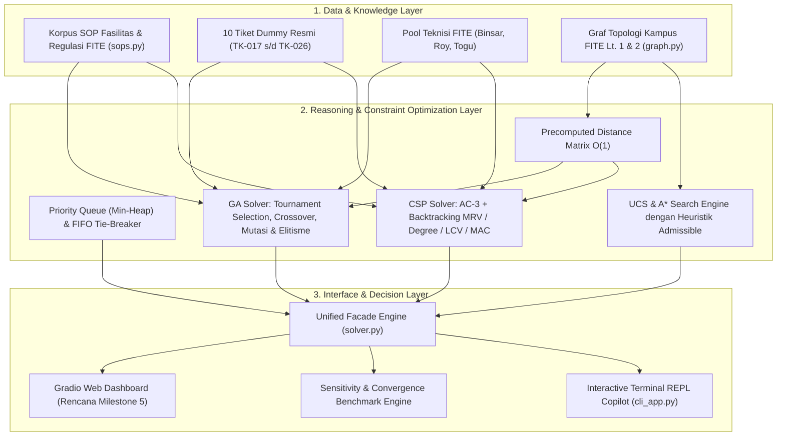

# Del-MaintOps Copilot

**Generative AI-Driven Facility Recommendation & Decision Support System for FITE IT Del**

Asisten cerdas bagi civitas akademika Fakultas Informatika dan Teknik Elektro (FITE) IT Del untuk melapor dan
menanyakan status kerusakan fasilitas gedung — proyektor/infokus, AC, jaringan/LAN lab, Idea Hub,
kelistrikan/colokan, CCTV, dan ruang kelas/labkom — sekaligus membantu tim sarana prasarana dan teknisi
memprioritaskan, mengalokasikan, serta menjadwalkan penanganan tiket secara optimal, terukur, dan mematuhi
seluruh batasan operasional (SOP, kualifikasi teknisi, dan SLA).

> Status Proyek: **Milestone 1 (W02) & Milestone 2 (W04) Terintegrasi Penuh** — Baseline Search, Constraint Satisfaction Problems (CSP) & Genetic Algorithm (GA) Optimization.

---

## Arsitektur Terpadu 5-Lapis (Milestone 1–5 Roadmap)



---

## Hierarki Direktori Restrukturisasi Proyek

Struktur proyek disusun secara modular, bersih, runtut, dan berorientasi enterprise:

```
del-maintops-copilot/
├── docs/                                 # Dokumentasi Teknis Terurut Runtut
│   ├── 01_problem_framing.md             # Latar Belakang & Perumusan Masalah Bisnis
│   ├── 02_peas_specification.md          # Spesifikasi Formal PEAS & Karakteristik Lingkungan
│   ├── 03_state_space_search.md          # Formulasi Ruang Keadaan (X, A, T, G, C) & UCS/A*
│   ├── 04_sops_knowledge_base.md         # Basis Pengetahuan SOP Terpadu (SOP-01 s/d SOP-08)
│   ├── 05_constraint_modeling_csp_ga.md  # Pemodelan Matematis Batasan Bisnis (CSP & GA)
│   └── 06_sensitivity_and_convergence_analysis.md # Analisis Sensitivitas & Kasus Ekstrem
├── src/                                  # Source Code Python Modular
│   ├── core/                             # Domain Models & Fundamental Structures
│   │   ├── __init__.py
│   │   └── models.py                     # Ticket, MaintenanceTicket, Technician, ScheduleSolution
│   ├── navigation/                       # Graf Topologi & Engine Pencarian Rute
│   │   ├── __init__.py
│   │   ├── graph.py                      # Graf Kanonikal Terpadu Gedung FITE (Lt. 1 & 2)
│   │   └── router.py                     # UCS, A* Heuristik Admissible, CampusDistanceMatrix
│   ├── optimization/                     # Mesin Inferensi Pemecahan Batasan
│   │   ├── __init__.py
│   │   ├── csp_solver.py                 # AC-3, Backtracking MRV/Degree/LCV/MAC
│   │   ├── ga_solver.py                  # Algoritma Genetika dengan Turnamen & Elitisme
│   │   └── solver.py                     # Unified Facade Engine
│   ├── knowledge/                        # Basis Pengetahuan & Data
│   │   ├── __init__.py
│   │   ├── data_loader.py                # 10 Tiket Resmi, Data Teknisi, Generator Kasus Uji
│   │   └── sops.py                       # SOP FITE, Deteksi Kategori & Urgensi
│   ├── interfaces/                       # Antarmuka Pengguna
│   │   ├── __init__.py
│   │   └── cli_app.py                    # Terminal REPL Interaktif Terpadu
│   ├── search_baseline.py                # Compatibility bridge untuk modul pencarian
│   ├── solver.py                         # Compatibility bridge untuk modul solver
│   ├── cli.py                            # CLI helper & entry point
│   └── copilot_cli.py                    # Terminal adapter
├── tests/                                # Test Suite Otomatis (54 Tests Passed 100%)
│   ├── test_01_search_baseline.py        # Pengujian UCS, A*, Priority Queue (M1)
│   ├── test_02_csp_solver.py             # Pengujian AC-3, Backtracking MRV/Degree/LCV (M2)
│   ├── test_03_ga_solver.py              # Pengujian GA Solver & Elitisme Monoton (M2)
│   ├── test_04_edge_cases.py             # Pengujian Kasus Ekstrem (Over-constrained, Surge, Solo)
│   ├── test_05_integration_and_cli.py    # Pengujian Integrasi End-to-End M1 -> M2
│   ├── test_copilot_cli.py               # Pengujian CLI Interaktif
│   └── test_validation.py                # Validasi Baseline Search
├── scripts/
│   ├── generate_unified_report.py        # Generator Laporan Terpadu (Word & PDF)
│   └── run_benchmarks.py                 # Eksekutor Analisis Sensitivitas
├── solver.py                             # Root execution entry-point (python solver.py)
├── Grup01-Tugas01.docx                   # Arsip Dokumen Laporan Tugas 1 (Milestone 1)
├── Grup01-Tugas02-Terpadu.docx           # LAPORAN UTAMA TERPADU (M1 + M2 BERSATU)
├── pyproject.toml
├── .gitignore
└── README.md
```

---

## Panduan Eksekusi

### 1. Eksekusi Solver (Milestone 2)
```bash
python solver.py
# Atau:
uv run python solver.py
```

### 2. Eksekusi Analisis Sensitivitas & Pengujian Kasus Ekstrem
```bash
python src/sensitivity_benchmark.py
```

### 3. Eksekusi Terminal Interaktif (Copilot CLI)
```bash
python src/copilot_cli.py
```
*(Menyediakan opsi interaktif lengkap: pelaporan tiket baru, antrean prioritas, perhitungan rute tercepat UCS/A*, dan optimasi alokasi multi-teknisi CSP/GA).*

### 4. Menjalankan Seluruh Test Suite Otomatis
```bash
pytest -v
```
*(Hasil: **54 / 54 PASSED** tanpa kegagalan).*

---

## Ringkasan Luaran & Tim Pengembang

| Komponen | Penanggung Jawab | Capaian Kunci |
|---|---|---|
| **AI Architect & Solver Engineer** | **Lucas Pardede** (12S24015) | Formulasi matematis formal CSP & GA, implementasi AC-3, Backtracking MRV/LCV, GA Elitisme |
| **Data Modeler & Knowledge Engineer** | **Ika Maria Manurung** (12S24021) | Models domain, graf kanonikal FITE Lt. 1 & 2, distance matrix O(1), pemetaan SOP |
| **QA, Sensitivity & Interface Lead** | **Geralda Natali Gultom** (12S24051) | Skenario kasus ekstrem, benchmarking sensitivitas, CLI interaktif terpadu, laporan gabungan |

- **Tag Rilis Repositori**: `v0.2-milestone2`
- **Laporan Dokumen Terpadu**: [`Grup01-Tugas02-Terpadu.docx`](file:///Grup01-Tugas02-Terpadu.docx) (menggabungkan Milestone 1 dan Milestone 2 secara utuh).
