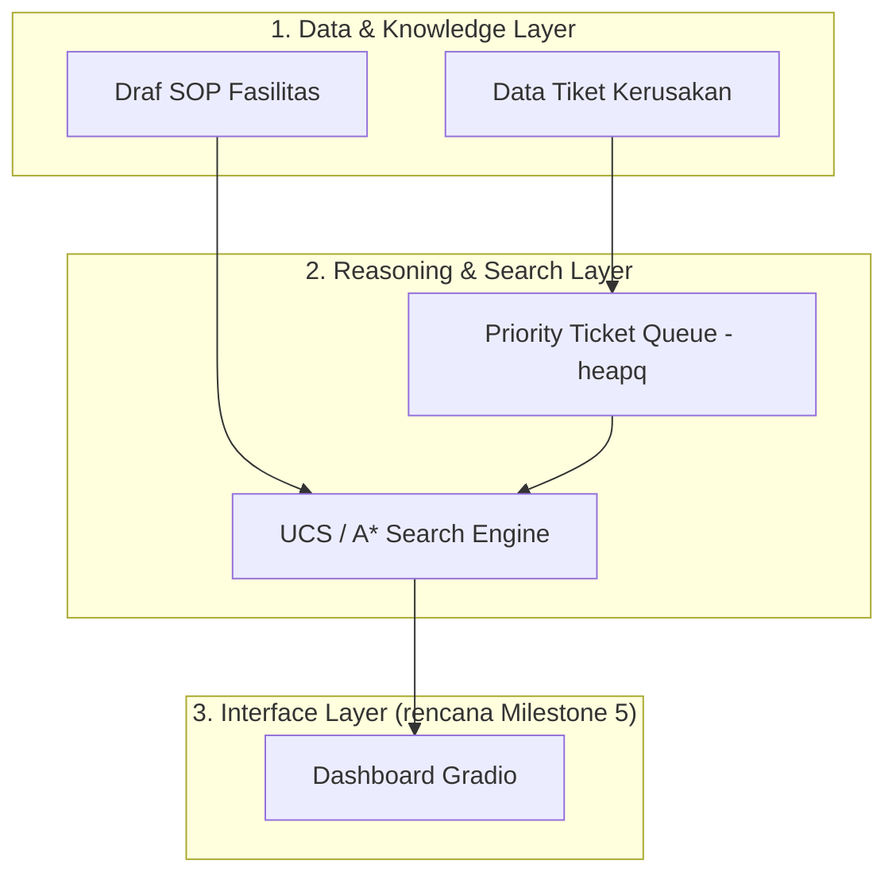

# Del-MaintOps Copilot

**Generative AI-Driven Facility Recommendation & Decision Support System for FITE IT Del**

Asisten cerdas bagi mahasiswa Fakultas Informatika dan Teknik Elektro (FITE) IT Del untuk melapor dan
menanyakan status kerusakan fasilitas gedung — proyektor/infokus, AC, jaringan/LAN lab, Idea Hub,
toilet, saung, dan ruang kelas — sekaligus membantu tim fasilitas memprioritaskan penanganan tiket
secara otomatis dan terukur.

> Status proyek saat ini: **Milestone 1 (W02)** — Problem Framing, Spesifikasi PEAS, Baseline
> Search (UCS/A*), dan inisialisasi repositori.

## Arsitektur Tingkat Tinggi (3 Lapis — Milestone 1)



Arsitektur penuh proyek akan berkembang menjadi 5 lapis (Data & Document, Knowledge & RAG, Agent &
Tool, Interface, Observability & Guardrails) sesuai roadmap Milestone 2–5.

## Struktur Direktori

```
del-maintops-copilot/
├── docs/
│   ├── problem_framing.md       # Bab 1: latar belakang & pain points
│   ├── peas_specification.md    # Spesifikasi PEAS + klasifikasi lingkungan
│   ├── sops_fite.md             # Basis pengetahuan SOP fasilitas
│   └── state_space.md           # Formulasi ruang keadaan (X, A, T, G, C)
├── src/
│   ├── search_baseline.py       # Priority queue + UCS + A* search
│   └── cli.py                   # CLI interaktif: lapor tiket, tanya SOP, rekomendasi rute
├── tests/
│   └── test_validation.py       # Pengujian QA (pytest)
├── pyproject.toml
├── .gitignore
└── README.md
```

## Instalasi & Menjalankan Proyek (Astral `uv`)

Proyek ini menggunakan [Astral `uv`](https://docs.astral.sh/uv/) sebagai manajer paket Python.

```bash
# 1. Install uv (sekali saja, jika belum ada)
curl -LsSf https://astral.sh/uv/install.sh | sh

# 2. Clone repositori
git clone <URL_REPO_TIM>
cd del-maintops-copilot

# 3. Sinkronisasi environment & dependensi
uv sync

# 4. Jalankan demo baseline search (non-interaktif)
uv run python src/search_baseline.py

# 5. Jalankan CLI interaktif (mahasiswa benar-benar bisa lapor & tanya ke bot)
uv run python src/cli.py

# 6. Jalankan pengujian QA
uv run pytest tests/ -v
```

## CLI Interaktif (`src/cli.py`)

Selain demo baseline yang hardcoded, tersedia antarmuka baris perintah agar interaksi
mahasiswa ↔ agen terasa nyata:

1. **Lapor kerusakan fasilitas baru** — mahasiswa memilih lokasi & mendeskripsikan
   kerusakan; sistem menyarankan urgensi otomatis berdasarkan SOP yang cocok (dengan
   eskalasi ke "kritis" untuk gangguan jaringan saat jam praktikum) dan memperingatkan
   bila laporan tampak duplikat.
2. **Lihat antrian tiket** — urutan prioritas dari `PriorityTicketQueue`.
3. **Minta rekomendasi rute teknisi** — menjalankan UCS & A* dari Posko Teknisi ke
   lokasi tiket berprioritas tertinggi berikutnya.
4. **Tanya SOP penanganan** — pencocokan kata kunci sederhana ke `docs/sops_fite.md`
   (placeholder Milestone 1; akan digantikan pipeline RAG/ChromaDB di Milestone 3).
5. **Lihat riwayat penanganan sesi ini**.

> Catatan lingkup: modul Q&A SOP di CLI ini murni pencocokan kata kunci, bukan RAG/LLM
> (itu baru masuk Milestone 3–4). Tujuannya hanya membuat interaksi Milestone 1 terasa
> nyata sambil tetap dalam batas materi search/priority-queue yang dinilai.

## Ringkasan Milestone 1

| Deliverable | Lokasi Berkas |
|---|---|
| Problem Framing (Bab 1) | `docs/problem_framing.md` |
| Spesifikasi PEAS | `docs/peas_specification.md` |
| Draf SOP (basis pengetahuan) | `docs/sops_fite.md` |
| Formulasi ruang keadaan | `docs/state_space.md` |
| Baseline search (heapq, UCS, A*) | `src/search_baseline.py` |
| CLI interaktif (lapor tiket, tanya SOP, rekomendasi rute) | `src/cli.py` |
| Pengujian QA | `tests/test_validation.py` |

## Tim & Pembagian Peran

| Peran | Tanggung Jawab Milestone 1 |
|---|---|
| Data & Knowledge Engineer & QA Lead | Problem framing, draf SOP, pengujian kode |
| Integration & Interface Engineer | Repo GitHub, `uv`, README, struktur folder |
| AI Architect | Formulasi state space, skrip baseline search |

## Mata Kuliah
10S3001 - Artificial Intelligence / Kecerdasan Buatan (3 SKS), Program Studi Sarjana Sistem Informasi,
Institut Teknologi Del — Semester Gasal 2026/2027.
