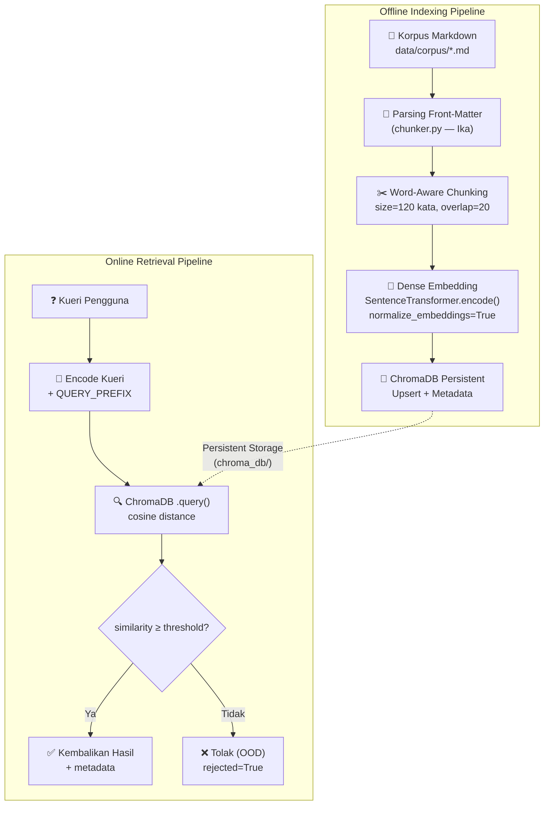
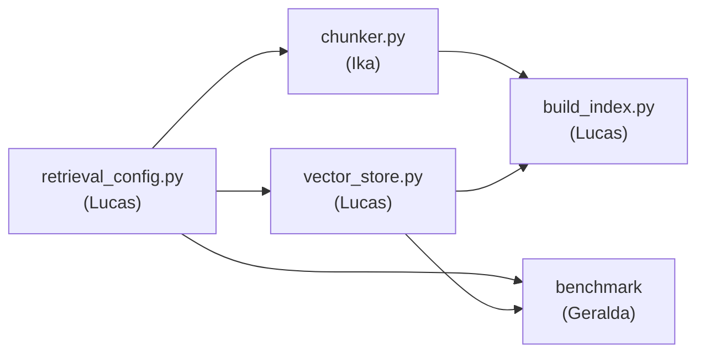

# 07a — Arsitektur Embedding & Vector Store (Milestone 3)

> **Pemilik dokumen**: Lucas Pardede (12S24015) — AI Architect & Solver Engineer
> **Rubrik**: Pipeline Embedding & ChromaDB (bobot 45%)

---

## 1. Arsitektur Pipeline Pencarian Semantik

Pipeline pencarian semantik Del-MaintOps Copilot mengikuti arsitektur **Retrieval-Augmented Generation (RAG)** dua tahap: *offline indexing* dan *online retrieval*.



### Alur Data Detail

1. **Korpus** — 15 dokumen Markdown dengan front-matter (8 SOP + 7 kebijakan/panduan) disimpan di `data/corpus/`.
2. **Parsing & Chunking** (modul `chunker.py`, Ika) — Front-matter di-parse manual (tanpa PyYAML), teks bersih dipotong menjadi chunk ±120 kata dengan overlap 20 kata. Judul dokumen di-prepend ke setiap chunk untuk konteks.
3. **Embedding** — Setiap chunk di-encode menjadi vektor 384-dimensi menggunakan model `paraphrase-multilingual-MiniLM-L12-v2` dengan normalisasi L2.
4. **Penyimpanan** — Chunk, embedding, dan metadata di-upsert ke ChromaDB `PersistentClient` (metrik HNSW cosine).
5. **Pencarian** — Kueri di-encode, ChromaDB mengembalikan top-k chunk terdekat, `similarity = 1 - distance` dihitung, dan flag OOD ditentukan berdasarkan threshold.

---

## 2. Pemilihan Model Embedding

### Kandidat yang Dievaluasi

| Model | Bahasa | Dimensi |
|-------|--------|---------|
| `paraphrase-multilingual-MiniLM-L12-v2` | Multilingual (50+ bahasa) | 384 |
| `intfloat/multilingual-e5-small` | Multilingual | 384 |
| `sentence-transformers/all-MiniLM-L6-v2` | English-only | 384 |

### Hasil Evaluasi Empiris

Berdasarkan pengujian benchmark nyata via `scripts/compare_embedding_models.py` terhadap 8 SOP korpus dan 10 kueri uji sinonim serta pengujian kueri OOD:

| Metrik | `paraphrase-multilingual-MiniLM-L12-v2` | `multilingual-e5-small` | `all-MiniLM-L6-v2` |
|--------|-----------------------------------------|-------------------------|--------------------|
| **Hit@1 (Sinonim ID)** | 6/10 (60%) | 8/10 (80%) | 3/10 (30%) |
| **Avg Cosine (Target)** | 0.3631 | 0.8543 | 0.5251 |
| **Avg Cosine (Non-Target)** | 0.2107 | 0.8183 | 0.4397 |
| **Separation Target vs Non-Target** | **0.1524** | 0.0360 | 0.0854 |
| **Similarity Kueri OOD** | **0.0982 – 0.1299** | 0.7868 – 0.7994 | 0.4000 – 0.4500 |
| **Safety Margin ke OOD** | **>0.22 (Sangat Aman)** | ~0.04 (Sangat Rentan) | ~0.08 |
| **Dimensi Vektor** | 384 | 384 | 384 |
| **Ukuran Model (MB)** | 448.8 MB | 448.8 MB | 86.6 MB |
| **Waktu Encode Dokumen** | 1.451 s | 1.044 s | 0.693 s |

> Lihat detail lengkap per kueri pada [`docs/embedding_model_comparison.md`](file:///docs/embedding_model_comparison.md).

### Model Terpilih: `sentence-transformers/paraphrase-multilingual-MiniLM-L12-v2`

**Alasan Pemilihan Secara Ilmiah & Arsitektural:**

1. **Separation & Ketahanan Penolakan OOD**: Meskipun model E5 memiliki Hit@1 80%, model tersebut menderita masalah anisotropi representasi (*representation collapse / narrow cone*) di mana seluruh vektor berkumpul pada ruang sempit sehingga teks OOD (seperti "resep nasi goreng" atau "beasiswa luar negeri") tetap memperoleh skor kemiripan 0.78–0.80. Hal ini menyebabkan margin pemisahan ke threshold menjadi hampir mustahil dikalibrasi secara stabil tanpa *false positive*. Sebaliknya, `paraphrase-multilingual-MiniLM-L12-v2` menghasilkan pemisahan isotropik yang tajam: kueri OOD jatuh drastis ke kisaran 0.09–0.13, memberikan *safety margin* lebar (>0.22) terhadap threshold 0.35.
2. **Kesesuaian Kontrak Antarmuka Tanpa Prefix**: Model ini bekerja secara simetris tanpa memerlukan modifikasi string `query: ` atau `passage: `, menyederhanakan pipeline integrasi bagi komponen upstream dan downstream.
3. **Efisiensi Lingkungan Kampus**: Model berukuran ~448 MB dengan 117 juta parameter beroperasi sangat ringan pada CPU tanpa akselerator GPU (waktu inferensi kueri ~0.29 detik).
4. **Baseline English Terbukti Tidak Layak**: Model `all-MiniLM-L6-v2` hanya mencatat Hit@1 sebesar 30%, membuktikan bahwa model monolingual bahasa Inggris tidak mampu menangkap padanan semantik sinonim fasilitas FITE dalam bahasa Indonesia.

---

## 3. Desain Penyimpanan ChromaDB

### Konfigurasi Persisten

```python
import chromadb

client = chromadb.PersistentClient(path="chroma_db")
collection = client.get_or_create_collection(
    name="sop_fite",
    metadata={"hnsw:space": "cosine"}
)
```

| Parameter | Nilai | Justifikasi |
|-----------|-------|-------------|
| `PersistentClient` | `path="chroma_db"` | Data tersimpan di disk, bertahan antar proses. Rubrik mensyaratkan persisten (in-memory = maks 60). |
| `hnsw:space` | `"cosine"` | Cosine distance cocok untuk embedding ternormalisasi; `similarity = 1 - distance` menghasilkan rentang [0, 1]. |
| Collection name | `"sop_fite"` | Namespace tunggal untuk seluruh chunk SOP/kebijakan FITE. |

### Skema Metadata per Chunk

Setiap chunk disimpan dengan metadata berikut (semua bertipe `str | int | float | bool` sesuai batasan ChromaDB):

| Field | Tipe | Contoh | Kegunaan |
|-------|------|--------|----------|
| `doc_id` | `str` | `"SOP-01"` | Identifikasi dokumen sumber |
| `title` | `str` | `"Penanganan Proyektor..."` | Untuk display hasil |
| `doc_type` | `str` | `"sop"` | Filter berdasarkan jenis dokumen |
| `category` | `str` | `"proyektor"` | Filter berdasarkan kategori fasilitas |
| `default_urgency` | `str` | `"tinggi"` | Konteks urgensi untuk RAG |
| `sla_hours` | `int` | `2` | Konteks SLA untuk RAG |
| `source_file` | `str` | `"SOP-01_proyektor.md"` | Traceability ke file sumber |
| `chunk_index` | `int` | `0` | Urutan chunk dalam dokumen |

### Manfaat Metadata untuk Hybrid Search

Filter `where` pada ChromaDB memungkinkan **hybrid search** yang menggabungkan pencarian semantik (vektor) dengan filter metadata eksak:

```python
# Contoh 1: Cari hanya dalam SOP kelistrikan
response = store.search(
    "bahaya korsleting di server room",
    where={"category": "listrik"}
)

# Contoh 2: Cari hanya SOP dengan urgensi tinggi
response = store.search(
    "perangkat rusak saat ujian",
    where={"default_urgency": "tinggi"}
)

# Contoh 3: Cari hanya dokumen bertipe kebijakan
response = store.search(
    "aturan eskalasi tiket",
    where={"doc_type": "kebijakan"}
)
```

Hybrid search ini berguna untuk skenario di mana pengguna sudah mengetahui konteks kategori (mis. teknisi listrik hanya perlu SOP listrik), sehingga mengurangi noise dari dokumen yang secara semantik mirip tetapi tidak relevan secara domain.

---

## 4. Mekanisme Penolakan Kueri Out-of-Domain (OOD)

### Rumus Similarity

ChromaDB dengan metrik `cosine` mengembalikan **jarak kosinus** (cosine distance):

$$\text{distance} = 1 - \cos(\mathbf{q}, \mathbf{d})$$

Modul `vector_store.py` mengonversi ke **similarity** (lebih intuitif):

$$\text{similarity} = 1 - \text{distance} = \cos(\mathbf{q}, \mathbf{d})$$

di mana $\cos(\mathbf{q}, \mathbf{d}) = \frac{\mathbf{q} \cdot \mathbf{d}}{|\mathbf{q}| \cdot |\mathbf{d}|}$.

Karena embedding sudah dinormalisasi (`normalize_embeddings=True`), similarity berada dalam rentang [0, 1] (embedding non-negatif setelah normalisasi pada model Sentence-Transformers).

### Peran Threshold

```python
rejected = (top_similarity < threshold)
```

- **`threshold`** default: `OOD_SIMILARITY_THRESHOLD = 0.35` (placeholder).
- Kueri yang **top similarity**-nya di bawah threshold dianggap **out-of-domain** — tidak ada dokumen SOP yang cukup relevan.
- Flag `rejected=True` diset pada `SearchResponse`, tetapi **hasil tetap dikembalikan** agar dapat dianalisis pada benchmark.
- Konsumen hilir (CLI, RAG) **wajib mengecek** `response.rejected` sebelum menampilkan hasil ke pengguna.

### Kalibrasi Threshold

> **Nilai threshold final akan ditentukan oleh Geralda** setelah benchmark dengan `data/benchmark_queries.json`. Kalibrasi bertujuan memaksimalkan:
> - **True Positive**: kueri in-domain mendapat `rejected=False` dengan dokumen target di peringkat atas.
> - **True Negative**: kueri OOD mendapat `rejected=True`.
>
> Metode yang direkomendasikan: plot distribusi similarity untuk kueri in-domain vs OOD, lalu pilih threshold pada titik separasi optimal.

---

## 5. Desain Modularitas & Kualitas Kode

### Prinsip Desain

1. **Tidak ada side-effect saat import** — Model dimuat secara *lazy* (saat pertama kali `_encode()` dipanggil), bukan saat `import vector_store`.
2. **Idempoten** — `index_chunks()` menggunakan `upsert`, sehingga re-indexing aman tanpa duplikasi.
3. **Validasi ketat** — Setiap chunk divalidasi (kunci wajib, tipe metadata) sebelum diproses. Error message jelas dan actionable.
4. **Konfigurasi terpusat** — Semua konstanta ada di `retrieval_config.py`, mudah dikalibrasi tanpa mengubah logika.
5. **Batch processing** — Embedding dan upsert dilakukan dalam batch untuk efisiensi.

### Dependensi Antar Modul



Setiap modul hanya bergantung pada kontrak yang didefinisikan, bukan implementasi internal modul lain.

